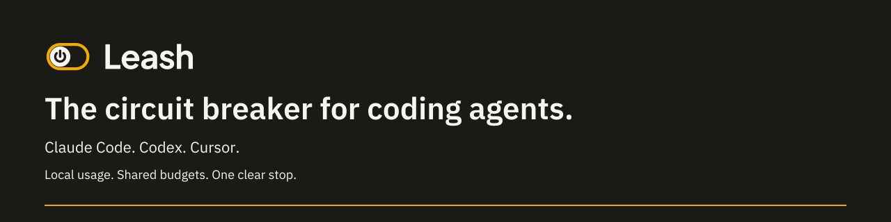
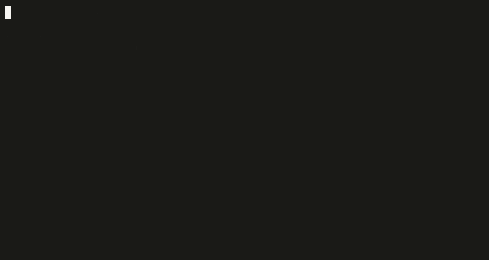

**[useleash.dev](https://useleash.dev)** · [Try the demo](https://useleash.dev/demo) · Install from source: `pnpm install && pnpm build && npm link`

[](LICENSE)

[](https://github.com/shalevamin/leash-cli/actions/workflows/ci.yml)

Leash is a circuit breaker for coding agents: Claude Code, Codex and Cursor. It tracks usage metadata, checks budgets and blocks the next prompt or tool call when the workspace is stopped.

Requires Node.js 22.13 or later. Node 24 is recommended. From a checkout of this repository:

```sh
pnpm install --frozen-lockfile
pnpm build
npm link
leash --version
```

You can also use the compiled download described at [useleash.dev](https://useleash.dev). Its [release manifest](https://useleash.dev/downloads/manifest.json) identifies the version, archive, size and SHA-256. Verify the downloaded archive against that manifest, then install the matching version:

```sh
npm install --global --ignore-scripts --prefix "$HOME/.local" ./leash-cli-<version>.tgz
export PATH="$HOME/.local/bin:$PATH"
```

Replace `<version>` with the downloaded version. The manifest may point to a different release than this source checkout. This package stays `private: true` to prevent accidental npm publication.

## Connect and install hooks

```sh
leash login
leash whoami
leash hooks install claude
leash hooks install codex
leash hooks install cursor
```

Install only the hooks for agents you use. Login opens a browser approval flow and saves a Leash credential privately. The default API is `https://api.useleash.dev`. Use `leash login --api https://api.example.com` for another compatible service. Remote APIs must use HTTPS; loopback HTTP is allowed for development.

In Codex, open `/hooks` and trust the installed Leash hooks. Restart an agent if it does not reload its hook configuration. Leash preserves other hooks and backs up an existing configuration before changing it.

```sh
leash hooks uninstall claude
leash hooks uninstall codex
leash hooks uninstall cursor
```

## Local and subscription mode

Keep using your agent's own subscription login. Leash does not take over that login or route subscription traffic through a proxy.

```sh
leash local start
leash local status
leash local stop
```

The watcher reads supported local usage logs, keeps a SQLite ledger and, while signed in, reports metadata to `/v1/local/usage` and checks `/v1/local/state`. Claude Code and Codex usage comes from session logs. Cursor usage comes from Leash's `afterAgentResponse` hook. Project identifiers are keyed hashes, not project paths.

The first start tracks usage from that point forward. `leash local start --since <ISO-date>` explicitly requests backfill. The watcher can terminate a supported agent process that continues producing usage after a fresh confirmed block. Use `leash local start --no-kill` to disable that fallback.

Local files live under `~/.leash` by default; set `LEASH_HOME` to use another directory. Signed-out hooks allow actions. A signed-out watcher can keep local metadata, but hosted budget decisions require login.



The demo uses synthetic input and a cached mock block. It contacts no hosted service and runs no agent command. Re-recording instructions are in [assets/README.md](assets/README.md).

## What's sent / what's never sent

For local/subscription usage reporting and control-plane sync:

- **Sent:** usage metadata only: tool, model, token counts, timestamps, session and project identifiers, estimated cost and enforcement state. Device mode also sends device/session identifiers and budget or report metadata.
- **Never sent as telemetry:** prompts, responses, code, file contents, OAuth or subscription tokens, or credential files.
- **Never read for subscription authentication:** credential files under `~/.claude`, `~/.codex/auth.json`, or Cursor authentication storage. Leash reads supported usage logs under agent directories and reads/writes hook configuration when you install hooks. It discards conversation content during usage parsing.

The CLI also includes optional API-key proxy and gateway clients. When you explicitly configure those modes, model requests and responses necessarily pass through the chosen provider route; gateway mode sends that traffic to the configured hosted gateway. These are separate from metadata-only subscription mode. Use provider API keys for those clients, never subscription or OAuth credentials.

`leash memory` builds a local code index for an explicitly selected project. `leash handoff` and `leash optimize` process the input you choose locally. They do not upload that content as telemetry. No `.env` file is discovered automatically; `LEASH_ENV_FILE` is an explicit opt-in to a trusted file.

## Hosted dashboard

[useleash.dev](https://useleash.dev) is the paid team and enforcement product: shared budgets, team policy, a workspace kill switch and a dashboard. Connect this CLI with `leash login`.

The CLI, hooks and local mode are open source under MIT. The hosted API, gateway, dashboard and billing are a separate hosted service; their source is not in this repository. The CLI does not connect directly to a hosted database.

## Limits

- Hooks fail open on errors. A confirmed cached block is retained briefly during an outage, then expires. Hooks are not an isolation boundary.
- Hooks check prompts and tool calls. They cannot stop a response that is already streaming.
- Codex requires the `/hooks` trust step before hook enforcement works.
- Usage reporting follows agent logs and can lag. Unknown models remain unpriced rather than being counted as free. Subscription usage estimates are not your subscription invoice.
- Optional process termination is a fallback, not a guarantee of immediate enforcement.

Use `leash --help` for API-key proxy, device enrollment, optimization, handoff, memory and sandbox commands. See [CONTRIBUTING.md](CONTRIBUTING.md) for development and [SECURITY.md](SECURITY.md) for private vulnerability reports.

MIT © 2026 Shalev Amin. See [LICENSE](LICENSE). Bundled IBM Plex fonts use the [SIL Open Font License](assets/fonts/OFL.txt).
